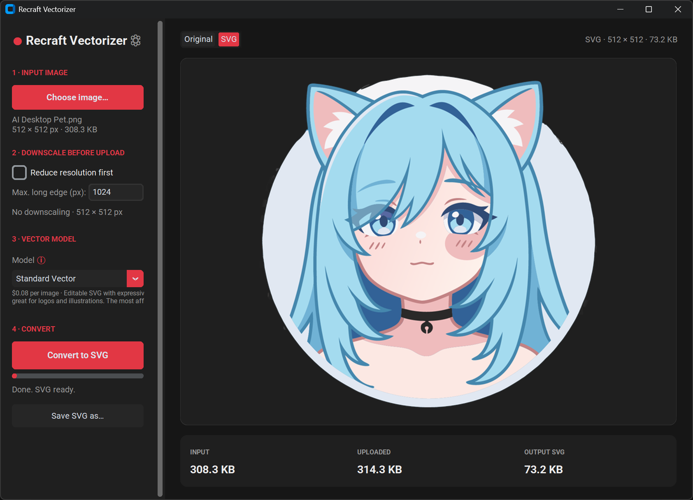

# Recraft Vectorizer

A small desktop GUI for converting local raster images (PNG, JPG, WebP, …) into
scalable **SVG** vector graphics using the [Recraft API](https://www.recraft.ai/docs/api-reference/examples).

Pick an image (or drag & drop one), optionally downscale it, choose a vector
model, and get an SVG back — previewed right inside the app with a before/after
toggle.



---

## Features

- **Local image → SVG** via Recraft's `/images/vectorize` endpoint.
- **Drag & drop** an image straight from Windows Explorer (or any file manager)
  onto the preview area.
- **Model dropdown** with friendly names and an **ⓘ info tooltip** describing
  each option and its price:
  - **Standard Vector** (`recraftv4_1_vector`) — $0.08 · editable, expressive SVG.
  - **Pro Vector** (`recraftv4_1_pro_vector`) — $0.30 · print-ready, finest detail.
  - **Utility Pro Vector** (`recraftv4_1_utility_pro_vector`) — $0.30 · clean,
    predictable, general-purpose.
- **Optional downscaling** before upload (set a max. long-edge in pixels) for
  faster uploads and smaller requests.
- **In-app preview** with an **Original / SVG toggle** so you can compare before
  and after.
- **File-size info** for the input, the uploaded image, and the resulting SVG.
- **Save as…** to export the SVG anywhere.
- **Settings dialog** to store your API key, a default download folder, and the
  default model.
- **Dark theme** with a red accent.

---

## Requirements

- Python **3.10+** (tested on 3.13).
- A Recraft API key — create one at <https://www.recraft.ai/> under
  *Profile → API*. Using the API consumes Recraft credits.

## Installation

```bash
# from the project folder
python -m venv .venv
# Windows
.venv\Scripts\activate
# macOS / Linux
source .venv/bin/activate

pip install -r requirements.txt
```

The SVG preview is rendered with **resvg** (a browser-faithful renderer that
handles gradients, clip-paths and CSS-class styling correctly), with **PyMuPDF**
as a fallback. Both ship self-contained wheels, so **no separate system
libraries are required**. If neither renderer is available the app still
converts and lets you save — only the on-screen preview is skipped.

## Usage

```bash
python recraft_vectorizer.py
```

1. Open **⚙ Settings** and paste your Recraft API key (and, if you like, set a
   default download folder and model). Click **Save**.
2. Click **Choose image…**, or **drag & drop** an image onto the preview area.
3. *(Optional)* Enable **Reduce resolution first** and set a max. long edge.
   The shorter edge is never scaled below **256 px** (Recraft's minimum).
4. Pick a **Model** — hover the **ⓘ** icon to compare quality and price.
5. Click **Convert to SVG**. When finished, the preview switches to the SVG.
6. Use the **Original / SVG** toggle to compare, and **Save SVG as…** to export.

---

## How it works

The core conversion calls:

```
POST https://external.api.recraft.ai/v1/images/vectorize
Authorization: Bearer <your-api-key>
multipart/form-data:  file=<image>, response_format=url
```

The response contains a URL to the generated SVG, which the app downloads,
rasterizes for the preview, and lets you save.

**About style & model:** the `/images/vectorize` endpoint is a faithful tracer —
it turns the pixels you send into paths. In testing it accepts a `model` field
(so the dropdown is passed through, with an automatic fallback to a minimal
request if it is ever rejected), but it does **not** apply artistic *styles* the
way the text-to-image generation endpoints do. A style dropdown would therefore
have been misleading, so it was removed. If you want a *stylized* redraw rather
than a faithful trace, that is a different Recraft endpoint (image generation /
image-to-image) and a possible future addition.

---

## Configuration & privacy

Settings are stored locally in:

```
~/.recraft_vectorizer/config.json
```

This file contains your API key in plain text. It never leaves your machine
except when the key is sent to Recraft (over HTTPS) to authorize a request. Keep
the file private and revoke/rotate the key from your Recraft account if needed.

---

## Troubleshooting

| Symptom | Fix |
| --- | --- |
| *"No API key set"* | Open **⚙ Settings** and paste your Recraft key. |
| *API error 401 / 403* | The key is wrong, expired, or out of credits. |
| *API error 400 / 422* | The image was rejected; try a different image or a smaller resolution. |
| Preview shows *"Preview could not be rendered"* | Reinstall requirements (`resvg-py`); the SVG still converted fine — only the on-screen preview is missing. |
| Drag & drop does nothing | Ensure `tkinterdnd2` is installed in the active environment. |
| Window looks unstyled | Ensure `customtkinter` is installed in the active environment. |

---

## Project layout

```
recraft-vector/
├── recraft_vectorizer.py   # the application (single file)
├── requirements.txt        # dependencies
└── README.md
```

## License

Provided as-is for personal use. "Recraft" is a trademark of its respective
owner; this project is an unofficial client and is not affiliated with Recraft.
